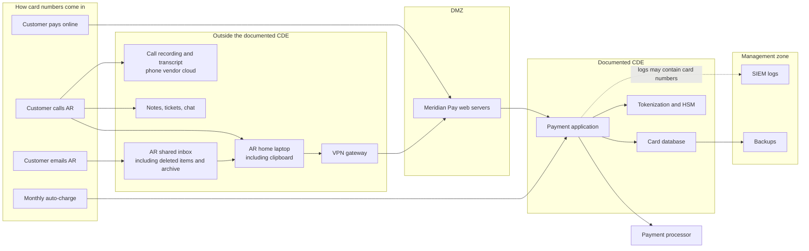

# Card Data Flow Map: Meridian Pay

> Fictional scenario. See [scenario.md](../scenario.md).

**Question this answers:** For every way a card number enters Sierra Meridian, where does it actually go?

**Why it matters:** PCI DSS applies to every system that stores, processes, or transmits card data. IT's documentation says card data stays inside the cardholder data environment (CDE). This map tests that claim.

## Summary

Card numbers enter the company four ways. Only one of them (online payment) stays close to the documented design. The other three put card data on remote laptops, the VPN, an outside phone vendor's systems, the company email system, and staff clipboards, none of which are inside the documented CDE.

## The Map

## The Four Paths

### Path 1: Online payment

| Step | Where the card number goes | In scope? |
|------|---------------------------|-----------|
| 1 | Customer's browser to the Meridian Pay web servers (DMZ) | Yes |
| 2 | Payment application, card database, tokenization, HSM (CDE) | Yes |
| 3 | Payment processor | Yes (outside party) |
| 4 | Logs sent to the SIEM (management zone) | Yes, if logs contain card numbers. Not yet checked. |
| 5 | Backups of the card database (management zone) | Yes. Backups hold the same data. |

**Gap from documentation:** logs and backups leave the CDE.

### Path 2: Phone payment

| Step | Where the card number goes | In scope? |
|------|---------------------------|-----------|
| 1 | The phone call | Yes |
| 2 | Call recording, stored by the phone vendor | Yes. Security codes must not be kept after payment is approved. |
| 3 | Automatic transcript of the call | Yes. A second copy. |
| 4 | Notes, tickets, or chat messages, if the number is written down | Yes |
| 5 | AR specialist's home laptop, where the number is typed | Yes |
| 6 | VPN connection into the company | Yes |
| 7 | Meridian Pay and the card systems (as in Path 1) | Yes |

**Gap from documentation:** card data reaches remote laptops, the VPN, and an outside vendor. The design document says employees never handle card numbers.

### Path 3: Email

| Step | Where the card number goes | In scope? |
|------|---------------------------|-----------|
| 1 | AR shared inbox, including every person with access to it | Yes |
| 2 | Deleted items, email archive, and email backups. "Usually deleted" does not mean gone. | Yes |
| 3 | Phones or tablets that sync the inbox | Yes |
| 4 | Replies and forwards that quote the original email | Yes |
| 5 | The specialist's clipboard when copying the number, which can be pasted anywhere | Yes |
| 6 | AR laptop, VPN, Meridian Pay, and card systems (as in Path 2) | Yes |

**Gap from documentation:** the whole company email system can fall into scope. Security codes sent by email are especially serious, because they must never be stored.

### Path 4: Monthly auto-charge (card on file)

| Step | Where the card number goes | In scope? |
|------|---------------------------|-----------|
| 1 | Card database to payment application (CDE) | Yes |
| 2 | Payment processor | Yes |
| 3 | Logs and backups (as in Path 1) | Yes |

**Gap from documentation:** none beyond logs and backups. This is the path that works as designed.

## Legal Note

Email retention creates a conflict. PCI DSS requires card data to be deleted when no longer needed, but company retention rules, archives, or a litigation hold may preserve every email in the AR inbox, including card numbers and security codes. That tension needs Legal's input before any cleanup, and it is a strong reason to stop accepting card data by email at all.

## What This Map Shows

1. The documented CDE is only part of the real one.
2. The biggest scope drivers are **people and processes** (phone and email payments), not servers.
3. The single change that would shrink scope the most is to **stop card numbers from reaching staff at all**: for example, send customers a secure payment link instead of taking numbers by phone or email.
